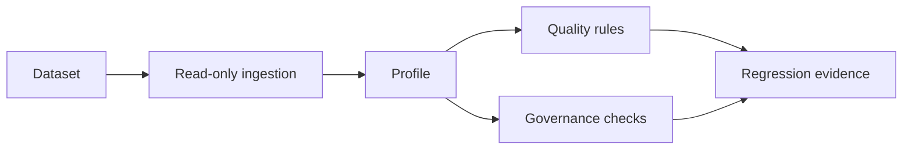

# dataOps

**Better data. More reliable AI.**

Local read-only dataset profiling, quality, governance and regression analysis for AI and data engineering.

  [](https://github.com/ops-universe/dataOps/actions/workflows/ci.yml)

> Development source repository. Public release is deferred. See [implementation status](docs/status/IMPLEMENTATION-STATUS.md) for scoped evidence and limitations.

## Why dataOps?

Inspect and compare data before using it in downstream training, retrieval or evaluation pipelines, without modifying source datasets.

## Features

- Bounded read-only CSV, JSON and JSONL ingestion.
- Missing/null, duplicate, type, numeric and category profiling.
- Deterministic quality rules, contracts and cross-field constraints.
- Split overlap, labels, fingerprints and heuristic governance checks.
- Dataset comparison, CLI and local dashboard with synthetic scenarios.

## Architecture



[Architecture](docs/architecture/overview.md) · [Quality](docs/architecture/quality.md) · [Regression](docs/architecture/regression.md)

## Quickstart

Requires Node.js 22+ and npm. Work from the repository root; the package is private and not presented as an npm release.

```sh
git clone https://github.com/ops-universe/dataOps.git
cd dataOps
npm ci
npm test
npm run demo
```

## CLI and examples

Use synthetic fixtures only.

```sh
node src/cli.mjs profile fixtures catalog.json
node src/cli.mjs quality fixtures catalog.json catalog.quality.json
# Optional local dashboard (stop with Ctrl+C)
node src/dashboard-server.mjs
```

## Configuration

Use a trusted dataset root. CLI: `profile ROOT DATA`, `quality ROOT DATA CONTRACT`, `governance ROOT DATA [IDENTITY...]`, `compare ROOT BEFORE AFTER [CONTRACT]`. Input limits: 8 MiB, 50,000 rows, 256 fields. CSV values remain strings. The local dashboard prints its loopback URL; never expose it through a proxy.

## Scope and limitations

No race-free filesystem sandbox, external AI or original-data mutation. Local dashboard is not authentication. Raw data, hashes, fields and aggregates can be sensitive. Heuristics/fingerprints do not guarantee anonymity or leakage prevention. No third-party security certification or production readiness.

Read the [threat model](docs/security/threat-model.md) before integrating with real data or systems.

## Roadmap

See [ROADMAP.md](ROADMAP.md) and [implementation status](docs/status/IMPLEMENTATION-STATUS.md). Developer Preview launch and public release remain deferred.

## Contributing and support

Read [CONTRIBUTING.md](CONTRIBUTING.md), [Code of Conduct](CODE_OF_CONDUCT.md), and [SECURITY.md](SECURITY.md). Open a focused [issue](https://github.com/ops-universe/dataOps/issues) with a minimal synthetic reproduction or documentation proposal. Run `npm ci` and `npm test` before opening a focused PR. Report security concerns using the security policy rather than public issues.

## Related projects

[evalOps](https://github.com/ops-universe/evalOps) · [guardOps](https://github.com/ops-universe/guardOps) · [ragOps](https://github.com/ops-universe/ragOps) · [traceOps](https://github.com/ops-universe/traceOps) · [mcpOps](https://github.com/ops-universe/mcpOps) · [workflowOps](https://github.com/ops-universe/workflowOps) · [Ops Universe](https://github.com/ops-universe)

## License

[MIT](LICENSE)
